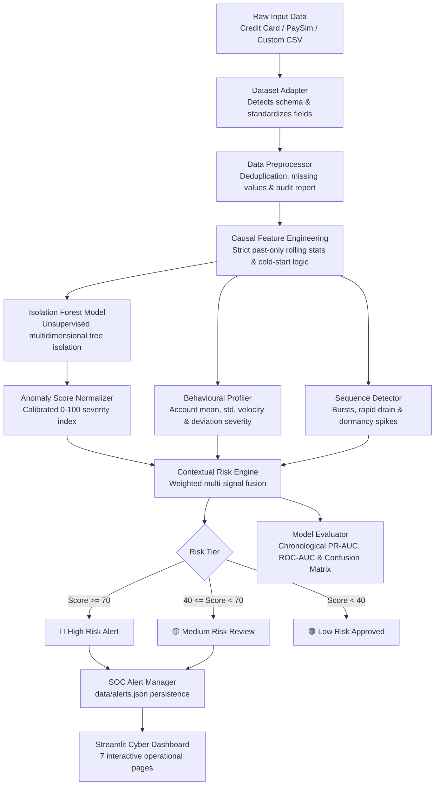

# 🛡️ Smart Banking Fraud Detector Using Machine Learning

[](https://www.python.org/)
[](LICENSE)
[](https://streamlit.io/)
[](https://scikit-learn.org/)
[]()

> A robust, explainable, and production-grade financial fraud detection system combining **unsupervised machine learning (Isolation Forest)**, **longitudinal account-level behavioural profiling**, and a **multi-signal contextual risk scoring engine**.

---

## 📌 Executive Summary

Traditional banking fraud detection relies heavily on rigid, handcrafted rule sets or supervised models trained on historical fraud labels. These legacy approaches suffer from two fatal weaknesses:
1. **Inability to detect zero-day fraud patterns:** Novel adversarial attack vectors do not match known fraud signatures.
2. **Excessive false positives:** Large transactions are often flagged blindly, irritating affluent or corporate customers whose typical spending is naturally high.

**Smart Banking Fraud Detector** addresses both flaws through a layered defence-in-depth architecture:
- **Unsupervised Anomaly Detection:** Utilises Scikit-learn's **Isolation Forest** to isolate rare multi-dimensional feature outliers without requiring historical fraud labels.
- **Account-Level Behavioural Profiling:** Calculates per-account spending baselines, transaction frequency, and velocity to differentiate between a legitimate high-net-worth purchase and an account takeover.
- **Contextual Risk Fusion Engine:** Combines machine learning anomaly severity, historical spending deviation, transaction velocity, temporal risk (night/weekend), and sequence violations into an explainable 0–100 composite risk score.
- **Rule-Based Sequence Detection:** Flags rapid transaction bursts, account draining sequences, and dormancy reactivations.
- **Interactive SOC Dashboard:** Provides a dark-navy financial cybersecurity interface with a persistent Alert Investigation Center, transaction deep-dive inspector, and chronological model evaluation suite.

---

## 🏗️ Architecture & Data Flow



---

## 🧰 Technology Stack

- **Language:** Python 3.11, 3.12, 3.14 compatible
- **Data Manipulation:** `pandas>=2.0.0`, `numpy>=1.24.0`
- **Machine Learning:** `scikit-learn>=1.3.0` (Isolation Forest, StandardScaler, OneHotEncoder)
- **Mathematical Utilities:** `scipy>=1.10.0`
- **Visualization:** `plotly>=5.18.0`
- **Dashboard:** `streamlit>=1.30.0`
- **Model Persistence:** `joblib>=1.3.0`
- **Automated Testing:** `pytest>=7.4.0` (31 unit & integration tests)

---

## 🚀 Quickstart & Installation

### 1. Prerequisites
Ensure you have Python 3.11 or newer installed.

### 2. Clone or Navigate to the Project Directory
```powershell
cd C:\Users\balaj\.gemini\antigravity\scratch\smart-banking-fraud-detector
```

### 3. Set Up a Virtual Environment
**Windows (PowerShell):**
```powershell
py -m venv venv
.\venv\Scripts\Activate.ps1
```

**Linux / macOS:**
```bash
python3 -m venv venv
source venv/bin/activate
```

### 4. Install Dependencies
```powershell
pip install -r requirements.txt
```

### 5. Run Automated Tests
Execute the full test suite to verify module integrity:
```powershell
pytest tests/ -v
```
*(All 31 unit and integration tests should pass in under 3 seconds).*

### 6. Launch the Streamlit Dashboard
```powershell
streamlit run app.py
```
Open your browser and navigate to `http://localhost:8501`.

---

## 📁 Project Structure

```
smart-banking-fraud-detector/
│
├── app.py                          # Streamlit SOC Dashboard (7 interactive pages)
├── requirements.txt                # Production Python dependencies
├── README.md                       # Comprehensive documentation & architecture guide
├── .gitignore                      # Git exclusion rules
├── .env.example                    # Configurable environment defaults
│
├── .streamlit/
│   └── config.toml                 # Streamlit dark navy theme configuration
│
├── data/
│   ├── sample/                     # Pre-packaged sample CSVs
│   │   └── banking_transactions_sample.csv
│   ├── synthetic/                  # Generated synthetic transactions & auth logs
│   │   ├── synthetic_transactions.csv
│   │   └── synthetic_auth_events.csv
│   └── alerts.json                 # Persistent SOC alert database
│
├── models/                         # Serialized model checkpoints (.joblib)
│
├── src/                            # Core detection modules
│   ├── __init__.py
│   ├── data_loader.py              # Schema adapters (Kaggle CC, PaySim, Custom) & generator
│   ├── preprocessing.py            # Validation, deduplication, cleaning, data quality report
│   ├── feature_engineering.py      # Strict causal rolling stats & cold-start fallbacks
│   ├── model.py                    # Scikit-learn Isolation Forest encapsulation
│   ├── anomaly_scoring.py          # Calibrated 0-100 anomaly severity normalizer
│   ├── behavioural_analysis.py     # Account spending baselines & deviation evaluation
│   ├── sequence_detection.py       # Burst, account drain, dormancy, & cyber kill chain detection
│   ├── risk_engine.py              # Contextual weighted risk scoring & explanation engine
│   ├── alert_manager.py            # Incident persistence, notes, and workflow statuses
│   ├── evaluation.py               # Chronological out-of-time evaluation (PR-AUC, ROC-AUC)
│   └── pipeline.py                 # End-to-end pipeline coordinator
│
└── tests/                          # Complete automated test suite
    ├── __init__.py
    ├── test_data_loader.py         # Adapter and file parsing tests
    ├── test_preprocessing.py       # Data cleaning and quality report tests
    ├── test_feature_engineering.py # Causality, cold-start, and temporal feature tests
    ├── test_model.py               # Model training, inference, and serialization tests
    ├── test_risk_and_sequences.py  # Score normalization, risk engine, and sequence tests
    ├── test_alert_manager.py       # SOC alert lifecycle and atomic persistence tests
    ├── test_evaluation.py          # Train/test split and performance metric tests
    └── test_pipeline_integration.py# End-to-end multi-dataset integration tests
```

---

## 📊 Dataset Support & Adapters

The system includes a smart `DatasetAdapter` that automatically parses different financial data formats:

| Dataset | Characteristics | Adapter Handling |
| :--- | :--- | :--- |
| **Kaggle Credit Card Fraud** | PCA features `V1`–`V28`, `Time`, `Amount`, `Class` | Anonymized (no account IDs). Retains `V1`–`V28` as model inputs. Disables individual profiling without inventing fake IDs. |
| **PaySim Synthetic** | `step`, `type`, `amount`, `nameOrig`, `nameDest`, `oldbalanceOrg`, etc. | Maps `nameOrig` to `account_id`, `step` to sequential timestamps, extracts transaction types and recipient categories. |
| **Custom Banking CSV** | Documented schema (`transaction_id`, `account_id`, `timestamp`, `amount`, etc.) | Direct canonical mapping with missing value imputation. |
| **Synthetic Multi-Scenario** | 7 realistic banking scenarios + simulated authentication logs | Includes normal spending, corporate baselines, rapid bursts, draining sequences, and vacation spending. |

---

## 🔍 Core Machine Learning & Risk Methodology

### 1. Isolation Forest (Unsupervised)
Isolation Forest isolates anomalies by randomly selecting a feature and randomly splitting between its min/max values. Since anomalies:
- Are topologically few
- Have attribute values distinct from normal clusters

They are isolated close to the root of the trees (short average path lengths).
- Contamination parameter is configurable (default `0.02`).
- Reproducible with fixed `random_state`.

### 2. Anomaly Score Normalization
Scikit-learn's `decision_function` returns positive values for normal instances and negative values for anomalies. The normalizer calibrates percentiles from training data:
$$\text{Normalized Score} = 100 \times \frac{\text{score}_{\max} - \text{raw score}}{\text{score}_{\max} - \text{score}_{\min}}$$
Bounded strictly in $[0, 100]$.

### 3. Behavioural Profiling & Cold-Start Logic
- **Baseline Requirement:** Requires $\ge 3$ historical transactions to establish an account baseline.
- **Cold-Start Fallback:** If an account has $< 3$ transactions, it is flagged with `is_cold_start = 1`. Deviation is evaluated against population baselines, and weight shifts towards machine learning anomaly detection.
- **False Positive Prevention:** An $\$8,000$ wire transfer is marked normal for a corporate account that regularly transacts $\$6,000$, but flagged as high risk for an account with a $\$40$ average.

### 4. Contextual Signal Fusion Formula
$$\text{Overall Risk} = w_{\text{ml}} S_{\text{ml}} + w_{\text{dev}} S_{\text{dev}} + w_{\text{vel}} S_{\text{vel}} + w_{\text{time}} S_{\text{time}} + w_{\text{seq}} S_{\text{seq}}$$
- Default weights: $\text{ML} = 0.35$, $\text{HistDev} = 0.25$, $\text{Velocity} = 0.20$, $\text{Timing} = 0.10$, $\text{Sequence} = 0.10$.
- Risk Tiers:
  - **Low Risk ($< 40$):** Processed normally.
  - **Medium Risk ($40 - 69$):** Out-of-band OTP / 2FA requested.
  - **High Risk ($\ge 70$):** Flagged for immediate block and analyst review.

---

## 🖥️ Streamlit Dashboard Walkthrough

The dashboard is structured into 7 dedicated operations pages:

1. **Overview:** Executive KPIs, risk distribution donut chart, score histogram, temporal scatter plot, and recent critical alerts.
2. **Data Management:** File uploader (up to 50MB), schema adapter selector, Data Quality Audit report, and synthetic attack scenario generator.
3. **Fraud Detection:** Searchable and filterable transaction ledger with an interactive deep-dive inspector showing radar/bar signal decomposition.
4. **Behavioural Analysis:** Account-level longitudinal profiles, transaction frequency, interval hours, and spending history timeline.
5. **Alert Centre:** SOC incident queue with status workflow (`New` $\rightarrow$ `Under Review` $\rightarrow$ `Resolved` / `False Positive`), analyst comments, and atomic JSON persistence.
6. **Model Evaluation:** Held-out chronological test evaluation featuring Precision, Recall, F1-Score, PR-AUC, ROC-AUC, False Positive Rate (FPR), and interactive Confusion Matrix.
7. **Settings & About:** Hyperparameter tuning sliders, custom risk weight calibration, and architecture documentation.

---

## 🛡️ Security, Ethics & Limitations

- **Simulated Environment:** This application is strictly an educational prototype and portfolio showcase. It **never** initiates real financial transactions or connects to live banking rails.
- **Anomaly $\neq$ Fraud:** Unsupervised anomalies highlight statistically unusual observations, not confirmed criminal guilt. All high-risk decisions require human analyst verification.
- **Zero Label Leakage:** Ground truth labels (`is_fraud`) are strictly isolated for out-of-time evaluation and never passed to the unsupervised training phase.
- **Input Validation:** Only CSV files are accepted. Script or executable uploads are blocked.

---

## 📄 License
This project is licensed under the MIT License - see the LICENSE file for details.
